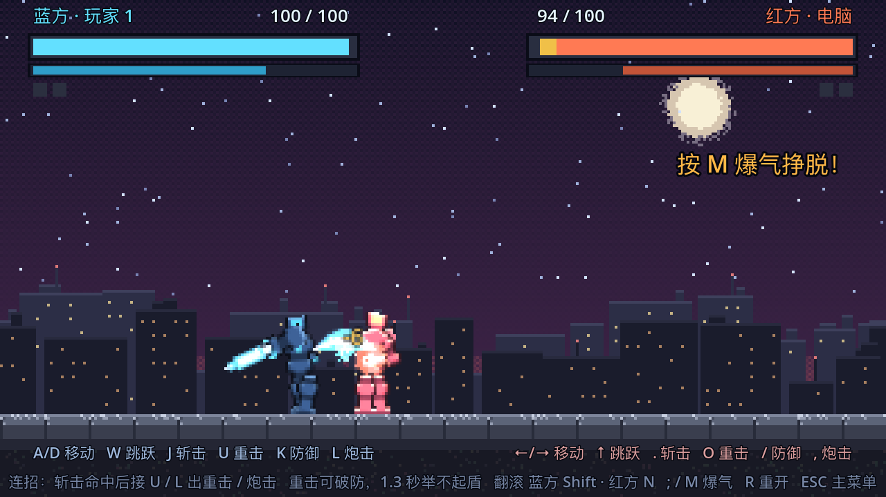
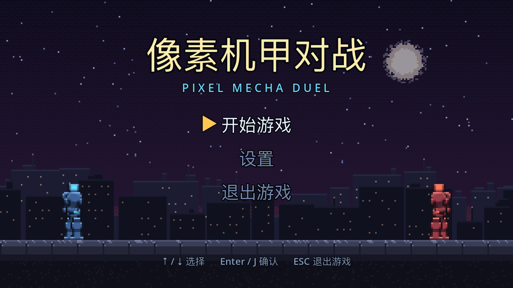
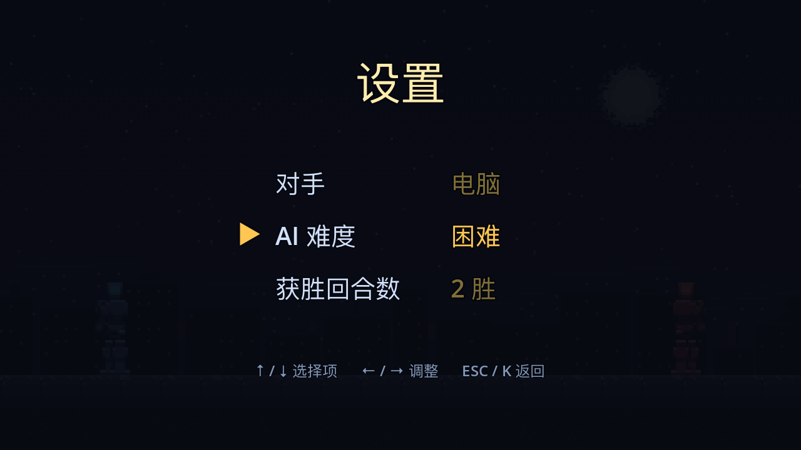
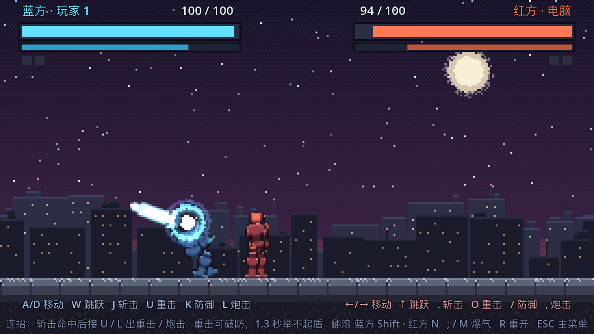
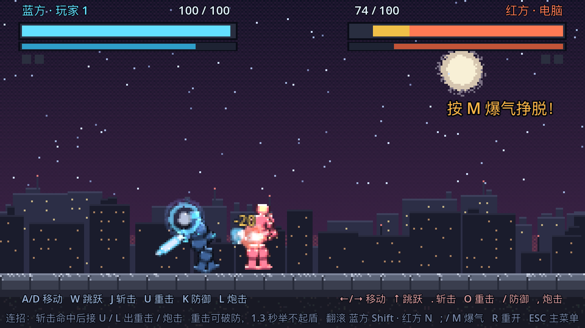
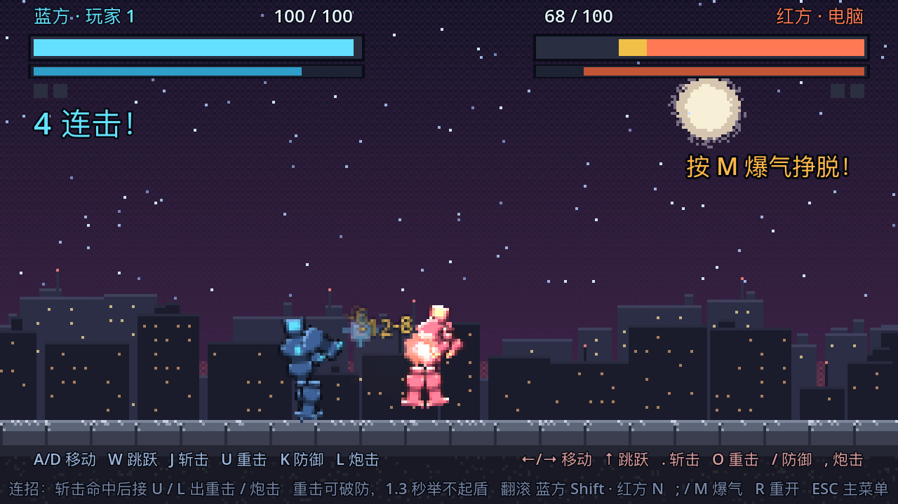
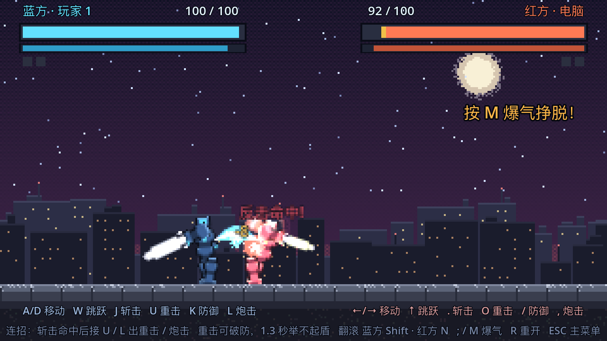
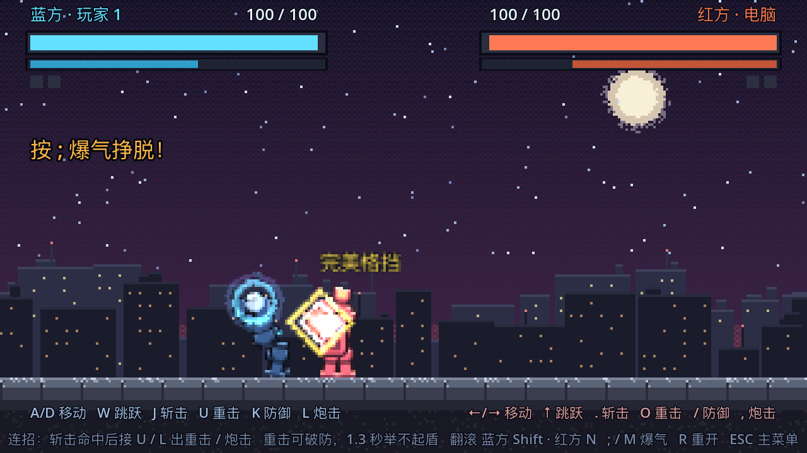
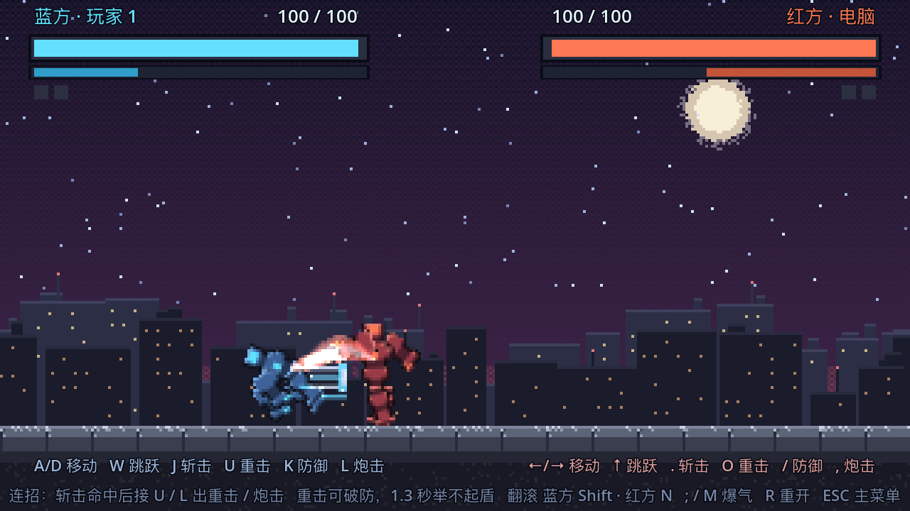
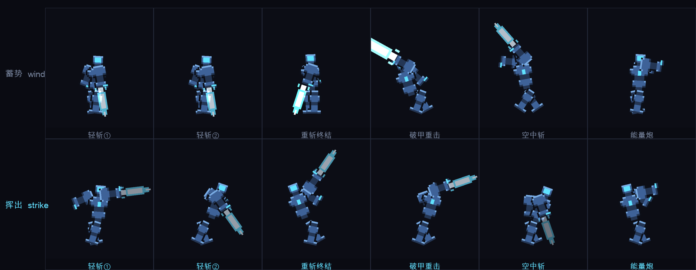

# 像素机甲对战 · 设计说明

一个用 **Godot 4.7** 制作的复古像素风格斗 Demo。
两台机甲在夜城战场贴身互搏：**近战连段、举盾读招、冲刺抢距离、能量炮压制**，三局两胜。



---

## 一、玩法设计

### 1.0 主菜单



启动即进入像素风主页：夜城背景 + 两台机甲分列左右对峙待机，标题缓慢浮动，选项光标闪烁。
三个选项：**开始游戏 / 设置 / 退出游戏**。

| 键 | 作用 |
| --- | --- |
| `↑` `↓` / `W` `S` | 选择菜单项 |
| `Enter` / `Space` / `J` | 确认 |
| `ESC` / `K` | 退出游戏 / 从设置返回 |

设置面板（← → 调整）：



| 设置项 | 可选值 | 影响 |
| --- | --- | --- |
| 对手 | 电脑 / 双人 | 红方由 AI 接管还是第二位玩家 |
| AI 难度 | 简单 / 普通 / 困难 | AI 的出刀率、读招格挡率、思考频率（`GameConfig.DIFFICULTY_TUNING`） |
| 获胜回合数 | 1 / 2 / 3 胜 | 拿下比赛所需的回合胜场，HUD 胜点数量随之变化 |

设置存在 `GameConfig` 的静态变量里，由菜单写入、对战场景读取，不需要 autoload。

### 1.1 核心循环

```
主菜单 → 对战：准备 → 开战 → 打到一方归零 → 回合结算 → 下一回合 → 两胜者拿下比赛
```

三局两胜（可在设置里改），每回合双方满血 100 重置。对战中按 `ESC` 返回主菜单。

### 1.2 操作

| 行为 | 蓝方（玩家 1） | 红方（玩家 2 / 电脑） |
| --- | --- | --- |
| 左右移动 | `A` / `D` | `←` / `→` |
| 跳跃（**不耗能量**） | `W` | `↑` |
| **斩击**（连段） | `J` | `.` 或小键盘 `1` |
| **破甲重击** | `U` | `O` 或小键盘 `4` |
| **防御**（按住，吃时机） | `K` | `/` 或小键盘 `2` |
| **能量炮**（远程，耗能极少） | `L` | `,` 或小键盘 `3` |
| **翻滚闪避**（独立按键） | `Shift`（或 `I`） | `N` 或小键盘 `5` |
| **爆气脱身**（受击时） | `;` | `M` 或小键盘 `0` |
| 重开 / 切换对手 / 返回主菜单 | `R` / `T` / `ESC` | 同 |

`T` 键可在「电脑 AI」与「双人本地对战」之间切换，单人即可试玩。
远程炮、翻滚闪避、爆气三者都是**互不冲突的独立按键**，不会误触发。

> 关于 `Shift`：它是键盘上**唯一的、两人共用的**物理按键。
> 如果给两名玩家都绑 `Shift`，就会出现「一个人按下、两台机甲一起翻滚」。
> 所以 `Shift` 只给蓝方，红方固定使用自己的 `N` / 小键盘 `5`——
> 双人模式下两人的按键空间完全不重叠。

### 1.3 招式表

所有招式按格斗游戏的 **startup（前摇）/ active（判定）/ recovery（后摇）** 三段式设计，
数值集中在 [mecha.gd](file:///Users/hunter/Desktop/像素风格游戏/scripts/mecha.gd) 的 `MOVES` 常量表里，改表即改手感。

| 招式 | 前摇 / 判定 / 后摇 | 伤害 | 受击硬直 | 击退 | 链式取消 | 必杀取消 | 浮空上限 `jl` | 起手递减 |
| --- | --- | --- | --- | --- | --- | --- | --- | --- |
| 轻斩 ① | **0.12** / 0.06 / 0.09s | 6 | 0.26s | 16 | → 轻斩 ② | **可** | 1 | **0**（连得最长） |
| 轻斩 ② | **0.12** / 0.06 / 0.12s | 7 | 0.34s | 20 | → 重斩 | **可** | 1 | 0（只能由轻①取消进入，当不了起手） |
| **重斩终结** | **0.12** / 0.08 / 0.36s | **15** | 0.40s | 60 + 挑飞 | — | **可** | 2 | 0.12 |
| **破甲重击** | **0.34** / 0.10 / **0.46s** | **22** | 0.52s | 74 + 挑飞 | — | 否 | **4**（最高） | 0.12 |
| 空中斩 | 0.06 / 0.11 / 0.12s | 9 | 0.30s | 24 | — | 否 | 3 | 0 |
| 能量炮 | 0.07 / — / 0.16s | 12 | 0.24s | 40 | — | 否 | 2 | 0 |

三个平A段（轻斩①②、重斩终结）的**前摇统一 0.12s**，后摇各自保留（0.09 / 0.12 / 0.36），
原因见 1.3.3。

后三列是**连招系统**的参数，含义见 1.4.3；`jl` 与「起手递减」都是越小/越大越有讲究的调参点，
改表即改连招手感。

每招的攻击动作也是**独立设计的关键帧剪影**，六个招式一眼分得开（实现见 2.5）：

| 招式 | 动作 |
| --- | --- |
| 轻斩 ① | **直刺** — 手臂收到身后 → 笔直前伸，后臂反向甩出去配重 |
| 轻斩 ② | **过肩下劈** — 刀举到身后上方 → 整条躯干前压着劈到膝前 |
| 重斩终结 | **上撩挑飞** — 刀沉在身前低位、屈膝下蹲 → 撩到身前上方、身体后仰成弓 |
| 破甲重击 | **蓄力大劈** — 手臂慢慢抡到身后上方、后仰扎马 → 猛地劈出并向前突进 |
| 空中斩 | **空中下劈** — 双腿在空中前后大张、刀举过头 → 一记劈到前下方 |
| 能量炮 | **托炮瞄准 → 后坐** — 双臂合拢把炮口推向前 → 被后坐力顶得后仰、双腿撑住 |

「重斩终结」是**上撩**、轻斩②是**下劈**，两者走向相反：这既让连段里三段近战一眼能数清，
也让「重斩会把对手挑到空中」这件事在动作上就说得通。

**三连段 = 6 + 7 + 15 = 28 伤害**（计入递减后约 24），约 4 套连段可破防制胜。

> 「重斩终结」和「破甲重击」是两回事：前者是连段的收尾，后者是独立的重招
> （按键 `U` / `O`），前后摇都极大但能**打穿防御**。详见 1.3.2。

### 1.3.1 破甲重击：前摇做成一眼可辨的蓄力动作

重击是全场最慢的招，所以它必须**在画面上先说话**——对手得有机会认出并做出反应
（翻滚躲开，或者踩点完美格挡），这个招才成立。因此前摇没有套用通用的
「起手抬臂」插值，而是单独写了一套三段姿态：



| 阶段 | 姿态 |
| --- | --- |
| **蓄力（0.34s）** | 手臂从体侧**慢慢抡到身后上方**、躯干后仰、前腿大步扎稳、重心下沉；光刃随进度越攒越亮、越攒越大，并在刀身反复喷出能量粒子 |
| **挥出（0.10s）** | 整条手臂猛地前劈、躯干前倾、**向前突进 5.5px**，打出最大的 `slash_c` 弧光 |
| **收招（0.46s）** | 手臂缓慢收回，期间完全无法行动 |

蓄力用的是 `k²` 缓动：前半段慢（看得清），后半段突然加速到位（有紧绷感）。
光刃在蓄力结束时亮度提升到 1.6 倍、尺寸放大 45%——不打字也能看出「这一下很重」。



> 蓄力粒子的尺寸是刻意收小的。第一版给得太大太亮，几层叠加后糊成一团光环，
> 反而把「抡刀」这个真正要传达的动作盖住了——**特效不能抢动作的戏**。

### 1.3.2 破甲（Guard Break）

| 项 | 值 |
| --- | --- |
| 对手**没**防御 | 22 伤害（全场最高） |
| 对手**正在**举盾 | **12 伤害**（22 × 0.55），而不是普通格挡的 1 点 |
| 附带的惩罚 | 破防硬直 0.75s + **1.3 秒内无法再举盾**（护盾直接碎掉） |
| 对手**完美格挡** | **完全免伤**，且攻击方反被钉住 1 秒 |

所以防御的完整博弈是这样闭环的：

```
一直举盾   → 吃 1 点削减伤害，能磨，但防不住重击
重击破防   → 12 点伤害 + 1.3 秒禁盾，是拆龟缩的正解
完美格挡   → 连重击都能挡下，还能反打 1 秒
重击的前摇 → 0.34 秒足够被读出来、被翻滚躲开或被踩点格挡
```

没有任何一招能无脑取胜：**重击克制龟缩，完美格挡克制重击，而 0.34 秒的明显前摇
又能被反应和闪避打回来**。这也是前摇必须「一眼可辨」的原因——它是这套博弈的前提。

### 1.3.3 平A 的前摇：从 3 帧加长到 7 帧

早期轻斩的前摇只有 **0.05s（3 帧）**，快到对手实质上来不及做任何反应，
于是「狂按平A」成了压制力最强的打法。现在三个平A段的前摇统一拉到 **0.12s（≈7 帧）**，
判定帧与后摇都没动。

| | 改前 | 改后 |
| --- | --- | --- |
| 出招到打中 | 0.05s（3 帧） | **0.12s（7 帧）** |
| 单次平A 全程 | 0.20s | **0.27s** |
| 三段连招全程 | 约 0.75s | 约 0.92s |

**为什么三段的前摇必须一致**：前摇一不一致，对手就能靠「哪段更快」反推来的是哪一招。
统一之后三段只能靠**动作剪影**去认（直刺 / 过肩下劈 / 上撩，见 2.5）——
这也正是「每段平A 配不同 rig」真正的意义。

#### 实测：狂按到底还能不能制胜

用脚本机器人「一路追着对手走 + 狂按平A」各打 8 秒（同一套脚本，只换帧数据）：

| 对手的应对 | 改前剩余血量 | 改后剩余血量 |
| --- | --- | --- |
| **站着不动** | **2** / 100（几乎被打死） | **15** / 100 |
| **一直举盾** | 74 / 100（只掉 26） | 73 / 100（只掉 27） |

结论要说清楚：**加前摇让出招变慢、变可读，但并不能单独解决「狂按制胜」**——
对着站着不动的对手，8 秒仍然能打掉 85 血。真正把伤害砍掉四倍的是**举盾**：
受击硬直占比 30% → 0%，伤害 85 → 27。

> 还有一条容易被忽略的机制：**出招期间 `_can_act()` 为 false，机甲不能移动**。
> 所以「远距离狂按」其实是原地空挥、根本追不上对手——狂按只能压住已经贴身（或被逼到墙角）的局面。
>
> 如果还想让进攻再弱一档，下一个真正有效的杠杆是**让三段连招不再是「真连段」**：
> 前摇只要 ≥ 0.20s，第二段的判定就会落到对手硬直结束之后，对手能挡下后面两段。
> 但那样「轻→轻→重」就从「必中连段」变成「帧陷阱」，属于设定层面的改动，要先确认要不要。

### 1.4 连段的成立条件（本作最核心的机制）

三段不是「按三下自动播」，而是真正的格斗游戏取消（cancel）系统：

1. **必须命中确认**：只有判定帧真正打中对手，才开放取消窗口。
   空挥三下什么都不会发生，乱按没用。
2. **判定帧结束后才能取消**：不能取消掉自己的前摇，所以不能无脑无后摇连击。
3. **输入缓冲**：攻击键在窗口开启前的按压会被缓存，窗口一开立即衔接，
   玩家不需要帧级精准的操作也能打出连段。
4. **可接的东西分两类**：一类是链式下一段（轻①→轻②→重斩），
   一类是**必杀取消**（命中后接能量炮 / 破甲重击）。两类共用同一个窗口，详见 1.4.3。

连段成立是靠帧数算出来的：轻斩①在 **0.12s** 打中，对手硬直到 **0.38s**，
而取消后轻斩②的判定在 **0.30s** 就落到了——**落在对手恢复之前**，所以是「真连段」。
重斩则正相反：它 0.12s 打中、对手硬直到 0.52s，而攻方要 0.56s 才收完招，
对手先恢复——所以重斩是终结技而不是循环。另外还有三层衰减
（连段递减、起手递减、浮空追打限制）负责把连段关在有限长度内，见 1.4.1 与 1.4.3。

> 这四条规则在代码里的落点：`_tick_attack()` 的取消分支（第 4 条）、
> `_physics_process()` 里的三个输入缓冲（第 3 条）、
> 以及 `_check_melee_hit()` 只认「打实了」的 `_hit_confirmed`（第 1、2 条）。

### 1.4.1 连段递减：为什么连打锁不死人

第一版有个致命 bug：轻斩总时长 0.20s，而受击硬直 0.26s，**硬直比招式还长**，
于是连续平 A 会让对手永远站不起来——数学上的死循环，玩家没有任何反击机会。

修法不是调数值，而是加一条格斗游戏通用的**连段递减（combo scaling）**：

```
第 n 段受击硬直 = 基础硬直 × max(0.3, 1 - 0.15 × (n-1))
第 n 段伤害     = 基础伤害 × max(0.3, 1 - 0.10 × (n-1))
```

- 递减计数器在**持续被打**时累加，只有「隔了 1.1 秒没再挨打」才归零
  （**不能**在受击方刚站起来的瞬间归零，否则衰减会被反复重置、等于没有）
- 下限压到 0.3 是关键：这样残余硬直（0.26×0.3≈0.08s）明显短于招式间隔（0.20s），
  受击方一定能拿到几帧行动窗口

实测结果（用最激进的「贴脸追打」脚本连打 8 秒）：
受击硬直占比 32%，**最长连续硬直只有 0.75 秒**，且中途能稳定拿回连续行动权。

### 1.4.2 爆气脱身：受击方的主动反击手段

被压制时按能量炮键（`L` / `,`）消耗 **50 能量**触发：

- 立刻脱离硬直、进入 0.55 秒无敌
- 用一次「零伤害命中」把对手震开并打出 0.30s 硬直，抢回回合权
- 清空自己的连段递减计数

HUD 会在受击方能量足够时闪出「按 ; / M 爆气挣脱！」提示，
让玩家在被压制的那一刻就知道自己还有手段。AI 也会用这招自救。

### 1.4.3 街霸式连招系统：四条规则

上一版的连段只有一条写死的「轻 → 轻 → 重」。这版把《街霸》连招系统的四个核心规则
按同样的小比例搬了进来，连招从「背一套固定顺序」变成**临场拼装**：



一条 `J J J L`（轻①→轻②→重斩→能量炮）的四段连招，HUD 打出「4 连击！」。

#### ① 必杀取消（Special Cancel）

普通技**命中之后**，后摇期间可以直接取消成**能量炮**或**破甲重击**，跳过本招剩下的后摇。

| 出招 | 结果 | 它是真连段吗 |
| --- | --- | --- |
| `J` → `L` | 轻斩① 命中 → 能量炮 | **是**：炮在对手硬直结束前就出去了 |
| `J` → `U` | 轻斩① 命中 → 破甲重击 | **否**，是帧陷阱：重击前摇 0.34s，对手会先站起来 |
| `J J J` → `L` | 轻① → 轻② → 重斩 → 能量炮 | **是**，四段连招，伤害 6+6+12+8 = **32** |
| `J J J` → `U` | 轻① → 轻② → 重斩 → 破甲重击 | 伤害最高但收尾能被挡，风险自担 |

关键在于，「按 `U` 直接出重击」和「轻斩命中后取消成重击」是两种完全不同的东西：
后者让一个 0.34s 前摇的重招**从一个必中的轻技后面长出来**——
这正是街霸里「轻技确认接必杀」的价值所在。代码在 `_tick_attack()` 里：

```gdscript
if _hit_confirmed and _atk_t >= swing:
    var special := bool(_move.get("special_cancel", false))
    if special and _buffered_heavy:                          # ① 取消成破甲重击
        _start_move("breaker")
        return
    if special and _buffered_shoot and meter >= SHOOT_COST:  # ② 取消成能量炮
        _start_move("shoot")
        return
    var nxt := String(_move["cancel"])                       # ③ 普通技链式取消
    if nxt != "" and _buffered_attack:
        _start_move(nxt)
        return
```

三种攻击键各自有独立的输入缓冲（`_buffered_attack` / `_buffered_heavy` / `_buffered_shoot`），
所以想接什么就在命中前按什么，不需要帧级精准。

每次成功衔接还会让光刃**爆闪一下**（见 2.5）——这是「这套连招真的接上了」
在画面上唯一的证据，否则只有 HUD 上的数字在动。反击命中时攻方也点一次同样的爆闪。

#### ② 起手递减（Starter Scaling）

街霸里同一套连段，用 `2MK` 起手和用 `2LP` 起手，后续伤害完全不同——这就是 starter rating。
本作把它简化成每招带一个 `starter` 值：**连段第一段用哪一招起手，就决定后面所有段位的衰减速度**。

```
第 n 段伤害 = 基础伤害 × max(0.3, 1 − 0.10(n−1) − starter)
```

轻斩①的 `starter = 0`，是最优起手，一套三连能打满；
破甲重击的 `starter = 0.12`，单发很痛，但打完之后连不上追加。
所以「先用轻技确认、再收重招」在数值上也确实是对的。

#### ③ 浮空追打（Juggle：JC / JL）

挑飞类招式（重斩、破甲重击、空中斩）会把对手打进**浮空状态**。
街霸用两个数管这件事：角色身上的 Juggle Count，和招式上的 Juggle Limit。
本作的简化模型：

| 项 | 含义 |
| --- | --- |
| 角色的 `juggle` | 0 = 站在地上 / 普通跳跃；被挑飞后 = 1；在空中**继续**被命中则递增 |
| 招式的 `jl` | 这一招能追打到第几段浮空 |
| 判定 | **`jl ≥ 对手 juggle` 才打得中**，否则整个判定框对那个对手失效（`take_hit` 直接返回 `whiff`） |
| 清零 | 落地即清回 0，所以再次起跳不会被上一轮的浮空限制卡住 |

| 招式 | `jl` | 能追到第几段浮空 |
| --- | --- | --- |
| 轻斩 ①② | 1 | 只能追刚被挑飞的对手 |
| 能量炮 / 重斩终结 | 2 | 两段 |
| 空中斩 | 3 | 三段——挑飞后跳起来打是它的主场 |
| 破甲重击 | 4 | 唯一能把对手从高空继续砸下来的招 |

于是「挑飞 → 跳起来追打」连得上，但**追不了无限**：越往后越必须换更重的招，
轻技在深浮空里会直接穿过对手打空。HUD 冒出「追打 x2」就说明这一下够格。

#### ④ 反击命中（Counter Hit）

打在对手的**前摇**上（`state == ATTACK` 且判定帧还没开），伤害 ×1.25、硬直 ×1.3，
并弹出红色的「反击命中！」。



实测：轻斩① 命中前摇中的对手，伤害 **6 → 8**（截图里红方掉到 92/100）。

这条与「破甲重击 0.34s 的长前摇」是天生的配合：重击蓄力那 0.34 秒里，
对手只要抢先出一刀就能吃到加成——**重击不能无脑放**，读招是有回报的。
而被反击的一方要吃更长的硬直，所以抢到先手的一方还能顺势接一套连段。

### 1.5 防御与攻防博弈

- 按住防御进入举盾：**不能移动、不能斩击、不能放炮**
- **普通格挡固定只扣 1 血**（不分招式轻重）
- 格挡后有 0.10s 防御硬直，期间无法解除防御
- **被格挡的攻击不能取消连段**：不给取消窗口，攻方必须吃完自己的后摇
- 格挡成功时**攻方也会被推开 34px**，把距离还给防守方

### 1.5.1 完美格挡（Just Guard）：防御要吃时机

一直按住防御只能拿到「扣 1 血」的保底收益。想要更高收益就必须踩点：

> **按下防御的 0.12 秒内挡到** → 完全免伤 + **把攻击方钉在原地整整 1 秒**（固定硬直，
> 不吃连段递减，并中断他正在出的招）+ 弹开 96px + 回馈 14 能量，
> 同时亮起金白色菱形闪光与「完美格挡」提示。

那 1 秒就是防守方拿回的、**完全无风险的进攻权**——足够走上去打一套完整三连。
所以防御不再是「按住就完事」：提前量太少会被打穿，一直按着只能吃削减伤害，
只有读准对手出招节奏才有那份回报。



特效颜色刻意**不走阵营配色**：两台机甲一个是青色系、一个是橙红系，
所以完美格挡单独用一套**金白色**（`GUARD_PAL`），保证在谁身上都一眼看清。

> 实现细节：判定「是否在防御」时不能只看 `BLOCK` 状态。同一物理帧里攻击方节点可能先执行，
> 防守方的 `BLOCK` 状态还没生效，于是完美格挡会漏判。
> 现在额外用「防御键按住 + 完美格挡窗口」来补上这一帧的时序差
> （`_block_held` + `_guard_t`），与本作固有的 1 帧输入延迟配合工作。
>
> 攻击方的 1 秒惩罚走 `force_stun()`：它必须先干净地把攻击状态收掉
> （清 `_move` / 关光刃 / 复位判定标记），否则被钉住的机甲会带着没打完的招式僵在原地。

### 1.5.2 翻滚闪避：独立按键 + 全程无敌，但代价很实在



**独立按键**触发（不再是双击方向）：蓝方 `Shift`（或 `I`），红方 `N` / 小键盘 `5`。
方向判定规则：

```
按住 A/D  → 朝按键方向滚
没按方向  → 朝角色当前面向滚
```

这样「往前压」和「往后撤」都由方向键决定，不按方向时也不会因为面向敌人而意外滚向敌人。

其余属性全部围绕「贵、短、有后摇」设计：

| 项 | 值 | 设计意图 |
| --- | --- | --- |
| 能量消耗 | **20**（≈2.2 秒自然回复） | 要用得起，但不能连滚 |
| 无敌 | **翻滚全程 0.20s 无敌** | 只要滚出来就一定躲得掉，是可靠的防御手段 |
| 距离 | 175px/s × 0.20s ≈ **38–49px** | 刻意压短：它是躲判定的手段，不是长途位移 |
| 后摇 | **0.18s 不可行动** | 乱滚会被对手抓后摇，所以时机很重要 |
| 表现 | 四肢收拢成球 + 绕身体中心转一整圈 + 速度线特效 | 一眼看出「他闪过去了」 |

翻滚动画的做法：节点旋转是绕自身原点（脚底）转的，直接转会变成「以脚为轴摔出去」。
这里补了一次平移把旋转轴搬到腰部：

```
p → C + R(θ)(p − C)    等价于    rotation = θ, position = C − R(θ)C
```

另外旋转符号要再乘上 `facing`：`Visual` 有 `scale.x = -1` 镜像，
镜像会把旋转方向翻转，不补这一下会出现「往右滚却在逆时针转」。
配合收拢的四肢，读起来就是一个真正的跟头。速度线用叠加混合的 `roll` 特效留下，
即使一闪而过也能被对手看清。

### 1.6 能量：从「打人回能」改成「随时间回复」

上一版能量主要靠命中获得，导致「谁进攻谁就有资源」的正循环。现在改成以时间为主：

| 来源 | 数值 |
| --- | --- |
| **随时间自然回复** | **+9 / 秒**（主要来源） |
| 命中对手 | +4（已从上版的 +12 大幅下调） |
| 被命中 | +3 |
| 成功格挡 | 攻方 +2 / 守方 +1 |
| 完美格挡 | **+14** |

| 消耗 | 数值 | 换算 |
| --- | --- | --- |
| 能量炮（远程） | **8** | ≈1 秒回复，所以远程变成常规骚扰手段 |
| 翻滚闪避 | **20** | ≈2.2 秒回复 |
| 爆气脱身 | **50** | ≈5.5 秒回复 |
| 跳跃 | **0** | 移动与起跳完全不占资源 |

这样「什么时候花能量」才成为真正的决策：是花 8 点远程压一下，还是攒着等一次翻滚或爆气。

HUD 上的细条就是能量条。

> 踩坑记录：`_hit_used` 与 `_hit_confirmed` 必须是两个标记。
> 早期只用一个「已命中」标记，而格挡分支提前 return 没有把它置位，
> 于是**一次挥砍的判定帧内每帧都会再结算一次伤害**（实测一次轻斩扣 4 次），
> 把格挡方 6 秒磨掉了 100 血。现在 `_hit_used` 无论是否被格挡都置位，
> `_hit_confirmed` 只标记「打实了」，两者各司其职。

### 1.6 能量炮：从主武器降级为特殊技

上一版里「互相开枪」是唯一的进攻手段，导致节奏单一。
现在能量炮是**消耗 30 能量的特殊技**：

| 来源 | 获得能量 |
| --- | --- |
| 命中对手 | +12 |
| 被对手命中 | +7（劣势方也能攒） |
| 成功格挡 | 攻方 +8 / 守方 +5 |

初始 50 能量（够放 1 发），满 100（3 发）。炮击伤害 12，命中给 0.18s 无敌帧
——这条很关键：**炮击给无敌帧，近战不给**，于是连射不会把对手锁死，
而近战连段能真正连起来。

HUD 上的细条就是能量条。

### 1.7 冲刺 / 后撤步

双击方向键触发，0.15s、250px/s、带 0.10s 无敌帧、冷却 0.5s。
双击向前 = 抢距离，双击向后 = 后撤步躲招式。这是本作的「立回」手段，
也是玩家从远距离进入斩击距离的主要方式。

### 1.8 电脑 AI

`AiBrain` 每 0.09 ~ 0.20s 重新决策一次（近身时思考更快）：

1. **读招**：对手进入前摇且距离 < 46px → 举盾（60% 概率，留失误空间）
2. **预警**：正面 130px 内有来弹 → 举盾
3. **压迫**：距离 > 36px 靠近；贴到 20px 内 35% 概率退半步重新起手
4. **抢距离**：中距离且冲刺就绪 → 45% 概率冲刺贴近
5. **压制**：远距离且能量够 → 50% 概率放炮
6. **出刀**：进入斩击距离 → 78% 概率出招（连段由取消机制自动衔接）

它返回的意图字典与人类玩家按键解析出的字典**结构完全一致**，
所以 `Mecha` 根本不需要知道对面是人还是电脑。

---

## 二、核心代码结构

### 2.1 场景树

```
Main (Node2D)                       scripts/main.gd      ← 回合编排、连击数、特效与顿帧
├── WorldView (SubViewportContainer, 640x360, stretch_shrink=2)
│   └── SubViewport (320x180)       ← 战场跑在这个「像素分辨率」里
│       └── World (Node2D)
│           ├── Sky / SkylineFar / SkylineNear / Ground(StaticBody2D)
│           ├── Mechas / Projectiles / FX
└── HUD (CanvasLayer, 640x360)      血条 / 残影 / 能量条 / 回合胜点 / 连击数 / 提示

Mecha (CharacterBody2D)             scripts/mecha.gd
├── Collision (CollisionShape2D 14x34)
└── Visual (Node2D)                 ← scale.x = ±1 完成左右翻转
    ├── LegBack / ArmBack
    ├── Torso
    ├── LegFront
    ├── ArmFront
    │   └── Muzzle (Marker2D)       ← 炮口，能量炮从此处生成
    ├── Blade (Sprite2D)            ← 光刃，跟随手臂位置与角度
    └── Shield (Sprite2D)

Projectile (Area2D)                 scripts/projectile.gd
```

### 2.2 职责边界

| 模块 | 职责 | 不负责 |
| --- | --- | --- |
| `Mecha` | 招式帧数据、状态机、命中判定、血量/能量、回合复位 | 不知道特效长什么样，不知道对手是谁 |
| `Projectile` | 直线飞行、命中检测；伤害数据由发射者打包传入 | 不含任何数值配置 |
| `AiBrain` | 输出与人类按键同构的意图字典 | 不直接操作 Mecha 的任何内部状态 |
| `FxLayer` | 一次性像素特效（光刃弧光、爆炸、火花） | 不知道战斗逻辑 |
| `GameHud` | 血量/能量/回合胜点/连击数显示 | 不知道战斗逻辑 |
| `Main` | 回合流程、连击计数、顿帧、特效编排 | 不直接改血量 |

### 2.3 命中判定：一条统一的伤害路径

近战**不另开伤害通道**，而是与炮弹共用 `Mecha.take_hit()`：

```
近战：判定帧内每帧做 AABB 相交（面朝右坐标系判定框 → 世界坐标镜像）
      → 命中则打包 hit 字典 → opponent.take_hit(hit)
炮弹：Area2D 的 body_entered → 打包 hit 字典 → take_hit(hit)
```

`hit` 字典统一携带
`{ dmg, hitstun, knock, lift, invuln, from, attacker, guard_break, jl, starter }`，
因此「伤害、硬直、击退、挑飞、无敌帧、破甲、浮空上限、起手递减」这套受击表现只有一份实现，
新招式只要往 `MOVES` 表里加一行。

> 判定框用 `Rect2` 手算 AABB 而不是再挂一个 Area2D：
> 场上只有两个角色，手算完全确定、好调试，也省掉一套碰撞层配置。

### 2.4 状态机

```
IDLE ─┐
RUN ──┼─▶ AIR ──(空中按攻击)──▶ ATTACK(air)
      ├─▶ ATTACK   轻①→轻②→重斩 的链式取消，命中后还可取消成能量炮 / 破甲重击
      ├─▶ BLOCK        按住 + 落地才成立，带 0.10s 防御硬直
      ├─▶ DODGE        翻滚闪避，0.20s 全程无敌 + 0.18s 后摇
      ├─▶ HURT         受击硬直，完全无法操作
      └─▶ DEAD         血量归零，Tween 播放倒地
```

状态推进集中在 `_advance_state()`，招式时序在 `_tick_attack()`，
动画只是状态的**表现层**（`_update_rig()`），三者解耦。

### 2.5 攻击动画：每招一套独立的关键帧剪影



上排是**起手收势**（startup 结束那一刻），下排是**挥出到位**（判定帧结束那一刻）。

#### 招式姿态表（数据驱动）

上一版的攻击只有一条通用曲线：把前臂从 `arm_from` 插值到 `arm_to`，
其余关节在出招期间是**写死的常数**。结果六个招式在画面上几乎一模一样，
只有手臂角度的数字不同——连招打起来看着就是同一刀重复三次。

这版把姿态做成 `MOVES` 表里的数据：每招带两帧关键剪影，7 个关节各给一个目标值。

```gdscript
"rig": {
	"wind":   {"af": -0.75, "ab": 0.85, "tor": 0.16, "tx": 2.8, "lf": 0.36, "lb": -0.38, "bob": 2.4},
	"strike": {"af": -2.55, "ab": -1.10, "tor": -0.36, "tx": -4.2, "lf": 0.22, "lb": -0.52, "bob": -2.4},
},
```

| 键 | 含义 |
| --- | --- |
| `af` / `ab` | 前臂 / 后臂角度：0 = 自然垂下，负 = 往身体前方抬，正 = 往身后抬（±1.57 水平，±3.14 竖直向上） |
| `tor` | 躯干俯仰（负 = 后仰，正 = 前压） |
| `tx` | 躯干前后位移（正 = 向前顶） |
| `lf` / `lb` | 前腿 / 后腿摆角 |
| `bob` | 重心高低（正 = 下蹲蓄势，负 = 上拔） |

时间轴只有三段，而且**完全落在既有的 startup / active / recovery 时长里**，
一帧都不额外加——所以连招的帧数时序不受动画改动影响：

```
startup   中立姿态 ──smoothstep──▶ wind      收势：让对手看得出要出什么
active    wind ───────匀速──────▶ strike    挥出：时长本来就短，读起来是「唰」一下
recovery  strike ────smoothstep──▶ 中立      收招：收得稳，不像弹回去
```

改手感只要动表里的数字，不用碰任何逻辑。破甲重击保留了自己的蓄力特例
（见 1.3.1）——它是这套姿态的**质量基准**。

#### 重做时挖出来的三个真问题

**① 关节插值系数太慢，手臂永远追不上关键帧。**
原来所有状态共用 `clampf(delta * 18.0)`（60fps 下约 0.30/帧）这一个一阶平滑系数。
而一次挥砍的关键帧在 4 帧里要跑掉约 3 弧度，0.30/帧的跟随意味着**滞后约 3 帧**——
手臂实际只走到目标的三成，动作就只剩「软绵绵地挪一下」。
这是攻击动画看起来「没做完」最主要的原因。

```gdscript
# 出招期间直接贴到关键帧曲线上——曲线自己已经是平滑的（smoothstep + 匀速），
# 再叠一层一阶平滑只会拖后腿；其余状态才继续用平滑过渡，避免站立/奔跑/受击硬切。
var k_rot := 1.0 if state == State.ATTACK else clampf(delta * 18.0, 0.0, 1.0)
```

不过直贴带来了一个新问题：**从奔跑 / 举盾 / 滞空切进出招时姿态差最大**
（举盾切出刀，前臂要一次甩过 1.57 弧度），一帧走完就是「跳」一下。
所以起手头 2 帧加了一道缓冲，做法不是降插值系数、而是**限制每帧最多走多远**：

```gdscript
if state == State.ATTACK:
    k_rot = 1.0
    if int(roundf(_atk_t * 60.0)) <= START_BLEND_FRAMES:   # 起招头 2 帧
        rot_limit = START_BLEND_STEP                        # 0.80 rad/帧 ≈ 46°
        pos_limit = START_BLEND_SHIFT
```

这样是**自适应**的，实测两组对照：

| 起手情形 | 第 1 帧 | 第 2 帧 | 第 3 帧 |
| --- | --- | --- | --- |
| 举盾 → 出刀（姿态差 1.24 rad） | 缓冲前 **89.7°**，缓冲后 **45.8°** | 45.8° | 44.7° |
| 待机 → 出刀（姿态差 0.33 rad） | 18.6°（**一步到位，没被拖慢**） | 30.3° | 16.3° |

姿态差大的切换被摊平到 2 帧、峰值速度减半；差本来就小的照样是「唰」的一下。

**② 只挪躯干一个部件，躯干会从肩膀处「滑出去」。**
`tx` 原来只加在 `Torso` 上，可手臂是独立的节点——一前倾躯干就和留在原地的手臂脱开，
腋下裂出一道缝，整个人像被拆开。现在**整个上半身**（躯干 + 两条手臂 + 护盾）
一起随 `tx` / `bob` 移动，双腿留在原地扎稳，这才是「前倾 / 后仰」该有的样子。

**③ 光刃在判定帧结束的瞬间凭空消失。**
`blade.visible` 原来断在 `_atk_t < swing`，于是手臂还在往前送、刀却已经没了，
挥砍的弧线被硬生生切掉。现在光刃从起手就亮起来（对手看得见「刀要来了」），
判定帧结束后再按后摇的 45% 淡出：

```gdscript
_blade_on = kind == "melee" and _atk_t < swing + recovery * BLADE_LINGER
fade = pow(1.0 - (_atk_t - swing) / (recovery * BLADE_LINGER), 2.0)   # 平方 → 先慢后快，像能量散掉
```

#### 光刃跟随手臂

光刃不是一个固定的贴图朝向：它挂在手臂末端，每帧按手臂角度重算位置与旋转：

```gdscript
var hand := Vector2(0.0, 13.0).rotated(arm_front.rotation)   # 手臂局部「下」方向
blade.position = arm_front.position + hand
blade.rotation = arm_front.rotation + PI * 0.5               # 水平贴图对齐到下垂手臂
```

因此挥砍时光刃会跟着手臂一起划出弧线。

#### 取消衔接也看得见

连招系统的规则（命中确认、必杀取消）光靠 HUD 上跳动的数字讲不清楚。
所以每次**成功衔接**（链式取消或必杀取消）时，光刃会爆闪一下、放大到 1.35 倍：

```gdscript
if nxt != "" and _buffered_attack:
    _blade_flash_t = BLADE_FLASH      # 0.09s 的爆闪，正好落在两招的接缝上
    _start_move(nxt)
```

反击命中时攻方同样点一次爆闪，和受击方的白色闪白对称——「我读招抢到了先手」
在接触点上就能看到。

> 翻转朝向用 `Visual.scale.x = -1`，所有关节角度都写在「面朝右」的坐标系里，
> 镜像由父节点变换自动完成，左右两侧动作不会出现镜像错误。

### 2.6 分辨率策略（像素风的关键取舍）

| 层 | 分辨率 | 缩放 | 目的 |
| --- | --- | --- | --- |
| 战场 | 320×180（`SubViewport`） | 整数 2× | 保留颗粒感，1 像素 = 屏幕 4 像素 |
| HUD | 640×360（`CanvasLayer`） | `canvas_items` | 中文用矢量字体渲染，小字号依然清晰 |

这是本项目解决「复古像素分辨率」与「中文 UI 可读性」冲突的核心手段。
配合 `window/stretch/scale_mode = "integer"`，窗口再放大也保持整数倍、不糊不抖。

### 2.7 打击感（Juice）

- **顿帧**：命中瞬间把 `Engine.time_scale` 压到 0.08，持续 0.035 ~ 0.07 秒后恢复
- **受击闪白**：`Visual.modulate` 提到 2.2 倍亮度 0.12 秒
- **击退分级**：轻斩推开 16px、重斩推开 60px 并挑飞，靠位移差异传达招式重量
- **残影血条**：血条后面跟一条延迟回落的黄色条，直观显示「刚刚掉了多少」
- **连击数**：同一方 1.1 秒内连续命中就累加，≥2 时在 HUD 弹出「N 连击！」
- **飘字**：普通命中 `-N`，格挡 `格挡 -N`，破防 `破防！`，完美格挡 `完美格挡`
- **连招系统的专属飘字**：反击命中弹红色 `反击命中!`，
  浮空追打第二段起弹紫色 `追打 xN`——这两个瞬间是新系统最需要被看见的地方

> 踩坑记录：顿帧协程必须**无条件**恢复 `time_scale`。
> 早期版本里「最后一击」的顿帧是在阵亡结算之后才恢复的，导致整局永久停在 0.08 倍速。

---

## 三、基础素材方案

### 3.1 全部素材由脚本生成

`tools/gen_assets.py`（Python + Pillow）程序化绘制所有像素图，不依赖第三方素材包：

```bash
python3 tools/gen_assets.py
```

生成物共 37 张 PNG：

| 目录 | 内容 |
| --- | --- |
| `assets/mecha/` | `{blue,red}_{torso,arm,leg,shield,blade}.png` — 10 个机甲部件 |
| `assets/fx/` | `{blue,red}_{bullet,muzzle,hit,spark,slash_a,slash_b,slash_c,burst,roll,charge,shatter}.png` — 22 张阵营特效，外加共用的 `guard.png`（金白色完美格挡） |
| `assets/scene/` | `sky / skyline_far / skyline_near / ground` — 4 张背景图层（主菜单与对战共用） |

### 3.2 部件尺寸与关节枢轴

机甲以**双脚中心为原点、面朝右**绘制。枢轴约定：腿/臂＝顶部中心，躯干＝底部中心。

| 部件 | 尺寸 | 枢轴 | 场景中位置 | 说明 |
| --- | --- | --- | --- | --- |
| Torso | 16×22 | 底部中心 | `(0, −14)` | 含头部、面罩、动力核心 |
| Arm | 8×14 | 顶部中心 | 前 `(1, −30)` / 后 `(−3, −30)` | 肩甲 + 上臂 + 炮管 |
| Leg | 8×14 | 顶部中心 | 前 `(2, −14)` / 后 `(−2, −14)` | 髋 + 大腿 + 小腿 + 脚掌 |
| **Blade** | 18×7 | 水平 +x | 运行时跟随手臂 | 光刃，`offset = (9, 0)` 让贴图从手部向前伸出 |
| Shield | 12×18 | 顶部中心 | `(2, −26)` | 仅防御时显示 |
| Muzzle | — | — | `(4, 13)` @ ArmFront 子节点 | 能量炮生成点 |

→ 机甲整体 16×34 像素，站在 `y = 150` 的地面上，头部在 `y = 116`。

> 躯干、两条手臂、护盾这四件是**一起动的**：出招时的 `tx` / `bob` 会同时加在它们身上，
> 双腿则留在原地不动（见 2.5 的②）。关节角度写在「面朝右」坐标系里，
> 朝左时由 `Visual.scale.x = -1` 整体镜像。

### 3.3 调色板

每个部件用 6 色字符调色板绘制（`O` 描边 / `D` 暗部 / `M` 主甲 / `L` 高光 / `G` 能量 / `W` 核心白）：

| 阵营 | 描边 | 暗部 | 主甲 | 高光 | 能量 |
| --- | --- | --- | --- | --- | --- |
| 蓝方 | `#0C0F18` | `#243654` | `#3E6298` | `#78AAD6` | `#60E2FF` |
| 红方 | `#180C10` | `#4C202C` | `#9A3C48` | `#E27A74` | `#FF7A54` |

自动化处理保证风格统一：

- 形状用矩形拼装 → 自动 **顶面提亮** → 自动 **底面压暗** → 统一 **1 像素描边**（4 邻域膨胀）
- 斩击弧光用参数化新月形生成：`yc = cy − curve·sin(tπ)`，厚度中部厚两端薄

### 3.4 场景图层

静态单屏战场（无摄像机移动），四层由远及近：夜空（Bayer 抖动渐变 + 星点 + 月亮）
→ 远景天际线（56px，带窗户灯）→ 近景工业剪影（44px，带天线与红色警示灯）
→ 金属地面（30px：高光表层 + 铆钉 + 缝隙 + 噪点暗部）。
固定随机种子，每次重新生成结果一致。

### 3.5 特效

| 素材 | 用途 |
| --- | --- |
| `slash_a` 22×15 | 轻斩 / 空中斩的斩击弧光 |
| `slash_b` 32×24 | 重斩终结的弧光 |
| `slash_c` 44×32 | 破甲重击的大弧光 |
| `bullet` 9×5 | 能量炮（暗色描边保证深色背景下可读） |
| `muzzle` 9×9 | 炮口十字星芒 |
| `hit` 12×12 | 命中爆炸，边缘带 ±0.9px 像素抖动（颗粒感的关键） |
| `spark` 9×9 | 格挡、打在地形的火花 |
| `burst` 30×30 | 爆气脱身的环形冲击波 |
| `guard` 30×30 | 完美格挡的双层菱形闪光 + 实心核心（**金白色，不走阵营配色**） |
| `roll` 22×17 | 翻滚闪避的横向速度线 |
| `charge` 26×26 | 重击蓄力的能量环（**刻意收小**，避免盖住抡刀动作） |
| `shatter` 30×30 | 破防时护盾碎裂的六道碎片 |

全部用叠加混合（Add）播放，避免在深色背景上糊成一坨黑边。

---

## 四、运行与验证

### 4.1 运行

需要 **Godot 4.7**（4.4+ 均可）：

```bash
# 命令行直接运行（启动即进入主菜单）
/Applications/Godot.app/Contents/MacOS/Godot --path .

# 或用编辑器打开 project.godot 后按 F5

# 重新生成像素素材（改了调色板/形状后）
python3 tools/gen_assets.py
```

主场景已在 `project.godot` 里设为 `res://scenes/menu.tscn`；
想直接进对战，把 `run/main_scene` 改成 `res://scenes/main.tscn` 即可。

### 4.2 工程结构

```
像素风格游戏/
├── project.godot                 工程配置（主场景=主菜单/分辨率/拉伸/像素对齐）
├── scenes/
│   ├── menu.tscn                 主菜单：夜城背景 + 对峙机甲 + 选项与设置面板
│   ├── main.tscn                 对战场景
│   ├── mecha.tscn                机甲：碰撞体 + 7 部件骨架（躯干/双臂/双腿/光刃/护盾 + 炮口标记）
│   └── projectile.tscn           能量炮
├── scripts/
│   ├── menu.gd                   主菜单导航与设置写入
│   ├── game_config.gd            全局设置（静态变量）+ AI 难度参数表
│   ├── ui_font.gd                统一加载系统中文字体（菜单与对战共用）
│   ├── main.gd                   回合流程、连击计数、顿帧、爆气提示、特效编排
│   ├── mecha.gd                  招式帧表 + 招式姿态表 + 攻防状态机 + 取消/浮空/反击 + 翻滚/格挡/破防（核心，约 1240 行）
│   ├── ai_brain.gd               电脑对手行为树（读招/压迫/抢距离/自救爆气/拆龟缩用重击）
│   ├── projectile.gd             能量炮
│   ├── fx_layer.gd               一次性特效
│   ├── hud.gd                    血条/能量条/回合胜点/连击数/爆气提示
│   └── input_setup.gd            运行时注册按键映射（战斗 + 菜单）
├── assets/                       全部像素素材（由 tools/gen_assets.py 生成）
├── tools/gen_assets.py           素材生成脚本
└── docs/                         本文档与截图
```

### 4.3 已验证的关键行为

用「驱动真实场景的无头自测脚本」在 60fps 固定步长下验证，全部通过。
其中针对「玩家不可能反击」「时机收益」「拆龟缩」的专项验证与实测数据：

| 组 | 验证内容 | 实测结果 |
| --- | --- | --- |
| **主菜单** | 三个选项文案、↑↓ 选择、确认打开设置、←→ 调整、ESC 返回 | 全部通过 |
| **开始游戏** | 菜单 → 对战场景切换、设置正确传入 | 成功 |
| 连段 | 轻 → 轻 → 重三连总伤害（含递减） | 6+6+12 = 24 |
| 取消门槛 | 空挥三下不造成任何伤害 | 0 伤害 |
| **必杀取消** | 轻斩① 命中后取消成破甲重击 / 能量炮 | 两条线都成立：`light1→breaker`、`light1→shoot` |
| **四段连招** | `J J J L`（轻①→轻②→重斩→能量炮） | HUD 打出「4 连击！」，总伤害 6+6+12+8 = **32**（截图实测 100 → 68） |
| **浮空追打** | 浮空上限不足时该招对浮空对手失效 | 轻斩①（`jl=1`）打 juggle=2 的对手 **0 伤害**；能量炮（`jl=2`）正常命中 |
| **反击命中** | 打在对手前摇上 | 轻斩① **6 → 8**（×1.25）；硬直 ×1.3 |
| **AI 连段** | 电脑能不能打出连段 | 通过（旧代码在出招途中把意图压成 false，缓冲永不生效，现已修掉） |
| **攻击动作** | 6 个招式的姿态是否一眼可分 | 见「招式姿态对照」图：轻①直刺 / 轻②过肩下劈 / 重斩上撩 / 破甲蓄力大劈 / 空中下劈 / 炮击托炮后坐 |
| **动画不动帧数据** | 重做动画后连招时序是否还成立 | 四段连招仍是 **32 伤害**（实测 100 → 68）、反击命中仍是 **6 → 8**，与改动画前一致 |
| **关节跟随** | 出招时手臂能否到达关键帧 | 修前滞后约 3 帧（4 帧要跑 3 弧度，0.30/帧只跟到三成）；出招期间改为直贴曲线后，画面姿态 = 表里的关键帧 |
| **光刃可见性** | 判定帧结束后光刃是否还在 | 修前判定帧一结束就消失、挥砍弧线被切掉；现已延伸到后摇的 45% 并平方淡出 |
| **上半身连贯** | 躯干前倾时会不会和手臂脱开 | 修前 `tx` 只挪躯干、腋下裂缝；现躯干 + 双臂 + 护盾整体移动，双腿扎在原地 |
| **起手缓冲** | 状态切换进出招时关节会不会跳 | 举盾→出刀第 1 帧由 **89.7° 摊平到 45.8°**（2 帧内分完）；待机→出刀不受影响，仍一步到位 |
| **平A 前摇** | 加前摇前后「狂按」的压制力 | 出招到打中 3 → **7 帧**；8 秒追击+狂按对站桩：剩 2 血 → **剩 15 血**；对举盾 26 → 27（硬直占比 30% → 0%） |
| **加前摇不动时序** | 加前摇后三段连招是否仍成立 | 7 项全过，含 `light1→light2→heavy`、两条必杀取消、反击命中 |
| **连打压制** | 追击+狂按 8 秒，受击方仍须有行动窗口 | 硬直占比 **30%**、最长连续硬直 **0.63s**（对手 70% 的时间可自由行动） |
| **按住防御** | 全程举盾面对连打 | 非硬直帧 **100%**，未被击穿 0 次 |
| **翻滚闪避** | Shift 触发、耗能与方向判定 | 扣 20 能量、全程无敌、位移 47–52px、后摇 0.18s 不可行动 |
| **闪避方向** | 按住 A/D 取按键方向；不按则朝面向 | 4 种情形全部正确（含「对手在背后」） |
| **键位隔离** | Shift 只属于蓝方 | 按 Shift 时红方位移 0.0；`p2_dodge` 映射里确认不含 Shift |
| **能量经济** | 自然回复与各项消耗 | +9/秒；远程 8、闪避 20；跳跃 0 |
| **破甲重击** | 前摇长、有蓄力预兆、前后摇时长 | 前摇 _atk_t=0.350（设定 0.34）；总长 0.889（设定 0.90）；前摇期间 3 次蓄力粒子且打不到人 |
| **破甲伤害** | 打穿防御 | 22 → **12**（普通格挡只有 1）；对手 0.75s 硬直 + **1.26s 禁盾**，且举盾中被破防会立刻掉出防御状态 |
| **重击 vs 完美格挡** | 踩点格挡能否挡下重击 | 完全免伤，攻击方反被钉住 0.98s |
| **重击不可取消** | 重击途中猛按轻斩 | 全程保持 `breaker`，不会被取消成连段 |
| **突进** | 判定帧向前突进 | 5.5px（实测时会被命中顿帧冻住，需等顿帧结束再量） |
| **完美格挡** | 踩准 0.12s 窗口挡下 | 完全免伤 + 回馈 14 能量 + **攻击方固定硬直 1.00s**（实测 1.05s 恢复行动） |
| **持续格挡** | 一直按住（错过窗口） | 只吃固定 1 点削减伤害，且**不会**把攻击方钉住 |
| 远程攻击 | 消耗极少能量、生成弹丸、命中扣 12 | 通过 |
| 爆气脱身 | 硬直中挣脱 | 扣 50 能量、脱离硬直、对手被震开 |
| 跳跃 | 不消耗能量 | 通过 |
| AI | 会交战并自救 | 通过 |

### 4.4 可继续扩展的方向

1. **取消分级**：街霸的帧表里每个招都标着 `C`（可取消成必杀）/ `SA`（只能取消成超必杀）/
   `SA2` / `SA3`。现在本作只有「可 / 不可」两档，加了超必杀之后就能照这套分级细化
2. **超必杀（SA）**：能量满 100 时消耗全部放一招，`MOVES` 表加一行 + 一个按键，
   正好和上面那条取消分级接上
3. **防反（Parry Counter）**：完美格挡成功后已有 0.14s 自硬直，期间接一个专属反击招即可
4. **挑飞后的倒地与受身**：现在重斩挑飞后落回 AIR 状态，
   加 `KNOCKDOWN` 状态后就能做出「倒地 → 受身 / 追击」的完整浮空段
5. **重击蓄力分级**：现在蓄力时长固定，可以按住蓄更久换更高伤害（派生一个蓄力槽）
6. **更多机甲**：`gen_assets.py` 的调色板是参数化的，换 6 个颜色常量即可产出新阵营素材
